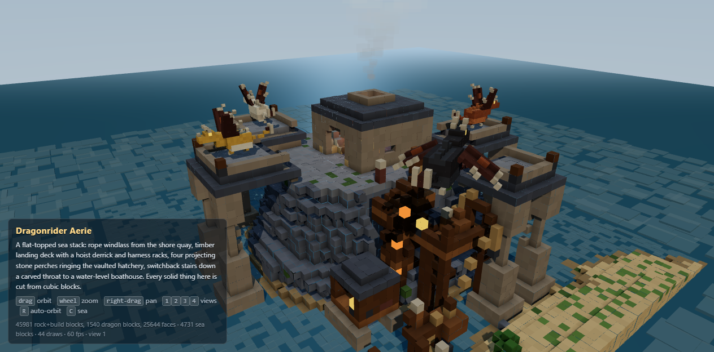

# Dragonrider aerie - a voxel sea stack, in one HTML file

This is the sample scene of the repo: what comes out of Qwen3.8-Flash-Next when you ask it
for something that takes real effort, instead of a benchmark. The aerie below was written end
to end by the model on the rig this repo documents (125B MoE, IQ3_S, both 1070s, 128K window).
It is also the sample that shows the value of a long window: the scene is 1,658 lines of
JavaScript in one document, and the model had to hold the whole thing while it debugged it.



Three.js core only, no addons, no `examples/jsm`. The one import in the file is
`three.module.min.js` r0.187.0 from cdnjs, and the camera controls are hand-written because
`OrbitControls` is not on that CDN.

## Run it

Open `index.html`. No build step, no server. It needs network access the first time for the
three.js import; to run it off-network, drop `three.module.min.js` next to the file and change
that one import line.

| Input | Does |
| --- | --- |
| drag | orbit |
| wheel / pinch | zoom |
| right-drag | pan |
| `1` `2` `3` `4` | the four framings: whole stack from the sea, landing deck and derrick, hatchery mouth and smoke hole, stairs down to the boathouse |
| `R` | auto-orbit |
| `C` | calm the sea |

The HUD in the corner is live: fps, block count, face count, draw calls.

## What the scene is

A flat-topped sea stack you haul yourself up by a rope windlass from the shore quay. On top:
four projecting stone perches ringing a vaulted hatchery cave with sand nests and a smoke hole.
A timber landing deck with a hoist derrick and harness racks on the east shoulder. Switchback
stairs cut down a carved throat to a water-level boathouse. Four beasts: three on the perches
with wings folded, one on the wing. Every solid thing is cut from cubic blocks - that is the
whole look, there is no mesh importing in this file.

## What it costs to draw

`AER.data()` in the console, or the HUD, same numbers:

| | |
| --- | ---:|
| rock and structure blocks | 45,981 |
| dragon blocks | 1,540 |
| merged faces | 25,644 |
| sea cells (animated top layer) | 4,731 |
| draw calls | 37-44 |
| triangles | ~225,000-228,000, per framing |
| fps, page's own counter | 60 |

Draw calls matter more than triangles here: the whole aerie is 2 merged meshes (one lit, one
for the emissive ids), plus instanced sea and smoke. Rebuilding the world costs CPU at boot,
not per frame.

The fps figure is the page's own counter in the four framings at a 1264x625 window. In the
headless gate it reads in the low 50s, because that harness pulls the back buffer each check -
capture cost, not scene cost.

## How the source is split

`index.html` is a build artifact, not the file you edit. The world is authored in numbered
fragments under `src/`, one per piece of the build:

| Fragment | Owns | Lines |
| --- | --- | ---:|
| `01-shell-palette-containers.txt` | HTML shell, the 26 voxel ids and their palette, the `Field` and `Bag` block containers | 275 |
| `02-seabed-shore-stack-hatchery.txt` | seabed, shore spit, the stack bands, the hatchery keep and nest chamber | 205 |
| `03-perches-landing-deck.txt` | the four perches with their masonry stairs, landing deck, derrick, harness racks | 176 |
| `04-quay-windlass-stairs.txt` | quay, windlass and lift, boathouse and boats, the switchback stair ribbon | 203 |
| `05-dragon-shapes.txt` | the authored beast shapes and pelts | 93 |
| `06-voxel-merge-ao.txt` | voxel-to-mesh merge, face culling, baked vertex AO | 149 |
| `07-render-rig-probe.txt` | renderer, sea and smoke, fog, the orbit rig, the four framings, the `AER` debug surface | 554 |

They are deliberately `.txt` and deliberately not modules: fragment 01 opens the document and
the module `<script>` tag, and the rest are consecutive bodies of that one script. So the order
matters, and no fragment parses on its own. The joiner appends the closing tags.

## Build

```powershell
cd projects/dragon-rider-aerie
./build.ps1 -Check
```

Writes `index.html` (UTF-8 without BOM, LF line endings) and then extracts the module body to
a temp file and runs `node --check` on it. Do this before committing: one stray brace shows up
as a blank page with a console error nobody bothers to open.

## Verifying a change you make

Two scripts in `tools/`, both need the [`agent-browser`](https://www.npmjs.com/package/agent-browser)
CLI on `PATH` (it drives a real Chromium, and the page sets `preserveDrawingBuffer: true` so the
back buffer can be read back).

```powershell
node tools/render-gate.mjs index.html 4     # all four framings
node tools/aim-shot.mjs index.html perch-corner 0.6 1.2 25 8 25 -14
```

The gate does not look at a screenshot and hope. For each framing it samples the back buffer and
asserts the rendered end state: how many distinct colours are on screen, how the pixels split
between dark and mid and bright, how much of the frame is solid geometry, where the silhouette's
bounding box lands, and
the page's error list. A scene of 46k blocks can be syntactically perfect and still be wrong,
and every one of these defects was caught by that sampling rather than by a compile:

| Defect, first pass | Why a syntax check cannot see it |
| --- | --- |
| A straight edge of sea tiles visible at the field bounds | the grid just stopped at +/-36 and the eye read it as a cliff of water |
| Perch decks floating off the cliff face | no footing block was in the wrong place, it was just not there |
| Beasts tinted close to the rock they stood on | the silhouette box said "beast is on screen" while the pixels said "beast is not readable" |
| A windlass lift line that went nowhere near the quay | geometry present, wrong purpose |

`aim-shot.mjs` is the manual version of the same idea: it snaps the camera to any yaw/pitch/
range and target point through `AER.cam`, so you can put one perch or the boathouse in frame and
check it still reads at that level after a change.

## Conventions worth keeping

- **One id per surface, in `T`.** A block's colour is its palette base plus a per-block jitter,
  plus a strata tint on rock and moss only. Without the jitter the same material reads as one
  smooth mass instead of a pile of cubes.
- **Only exposed faces get merged.** Interior blocks cost nothing; 45,981 blocks become 25,644
  faces.
- **Ambient occlusion is baked at merge time**, three corners per face, into vertex colours. No
  post pass.
- **Emissive ids** (`EMBER`, `FLAME`, `EYE`) merge into a second mesh with
  `MeshBasicMaterial`, so torches and eyes light themselves.
- **`Field` is a bounded dense grid, `Bag` is an unbounded sparse one.** Dragons go in `Bag`
  because they move. Gotcha: `Field.block` takes `[min]` and `[max]` arrays, while `fill`,
  `carve`, `strand` and `rim` take numbers. Mixing them up is the crash you get, and it shows up
  late as a reference error, not a type error.

## Limits, honestly

- The file is one document with no bundler and no module system. Splitting it into real ES
  modules is the obvious next refactor, and the fragment split is most of the work already.
- Boot costs CPU time authoring ~48k blocks; on a low-power laptop the first frame is not instant.
- The sea is a 4,731-cell instanced grid plus a non-voxel plate beyond it, not a shader. The
  plate exists because the voxel field has bounds and the eye finds them.
- Nothing here is physics or game-ready. It is a static authored scene that happens to look
  three-dimensional.
