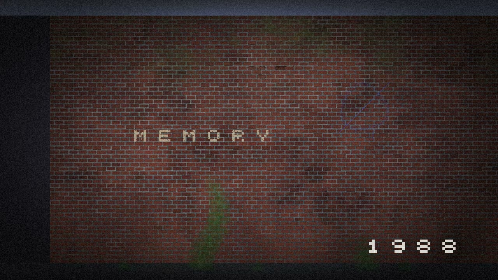
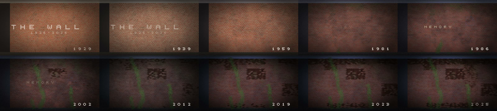

# The Wall - 100 years in 15 seconds

One brick wall, one fixed tripod camera, and a century passing across it in
15 seconds: 1926 to 2026. Everything on screen and on the soundtrack is computed
from simulation math - no diffusion model, no stock footage, no sampled audio.
Decay here is a deterministic model, not noise: joints erode before faces
spall, soot climbs by capillary rise, moss descends from the parapet, cracks
initiate at corners and grow along seeded paths.



Twelve story points of the cut, title card to final frame:



## Render it

```
node render.mjs out          # 450 PPM frames + out/audio.wav - pure Node builtins, zero deps
ffmpeg -framerate 30 -start_number 0 -i out/frames/f%04d.ppm -i out/audio.wav \
  -c:v libx264 -preset slow -crf 20 -pix_fmt yuv420p -c:a aac -movflags +faststart wall.mp4
```

Full render (450 frames + audio) takes 6.5 minutes on this machine. The
renderer is deterministic from seed `7311`: a fresh run was verified against
the cut's frames - all 449 surviving PPMs hash-identical, and `audio.wav`
hash-identical.

## Numbers

| | |
|---|---|
| Resolution | 1280x720 @ 30 fps, 450 frames, 15.000000 s exact (ffprobe) |
| Wall | 53 x 60 brick modules, each with seeded hue/sat/luma, joint erosion rate, soot channel, spall year, salt threshold |
| Renderer | 850 lines, 48 KB, Node builtins only |
| Audio | 44.1 kHz stereo s16, synthesized: drone bed, mechanical year ticks, two spray-can hises, seven collapse crashes, resolving chord |

## The three cuts, honestly

The film shipped as three artist's cuts: v1 established the look, v2 fixed the
composition and brightness (wall luma 45.8 to 59.0 at the middle frame), v3
added the story beats. v3 was not a rerender from scratch - it was a ~30-line
edit of `render.mjs`. That is the point of this experiment: procedural means
editable. No rerolls, only rerenders.

## Spec vs. shipped

[`SPEC.md`](SPEC.md) is the drafted spec. Where the shipped cut deviates:

- Spec asked for 1920x1080; the cut renders 1280x720 - the pixel budget let a
  450-frame pass finish in minutes, and at this distance nothing is lost.
- Spec predates the graffiti. The v3 cut adds two seeded spray tags (a
  chalk-cream `MEMORY` stencil, a blue ring-and-cross throw-up) with a
  spray-can hiss at the instant they appear - the only human sound in the film.
- The closing beat: the last standing column topples at ~14.4 s. The spec
  called for "the camera settles"; this is the one movement the camera does not do.

## Files

- `render.mjs` - the renderer, one file, deterministic
- `SPEC.md` - the drafted spec, idea and simulation notes included
- `preview.jpg`, `contact-sheet.jpg`, `final-frame.jpg` - stills; the mp4 cuts
  are 40 MB each and belong nowhere in a repo - render it yourself
